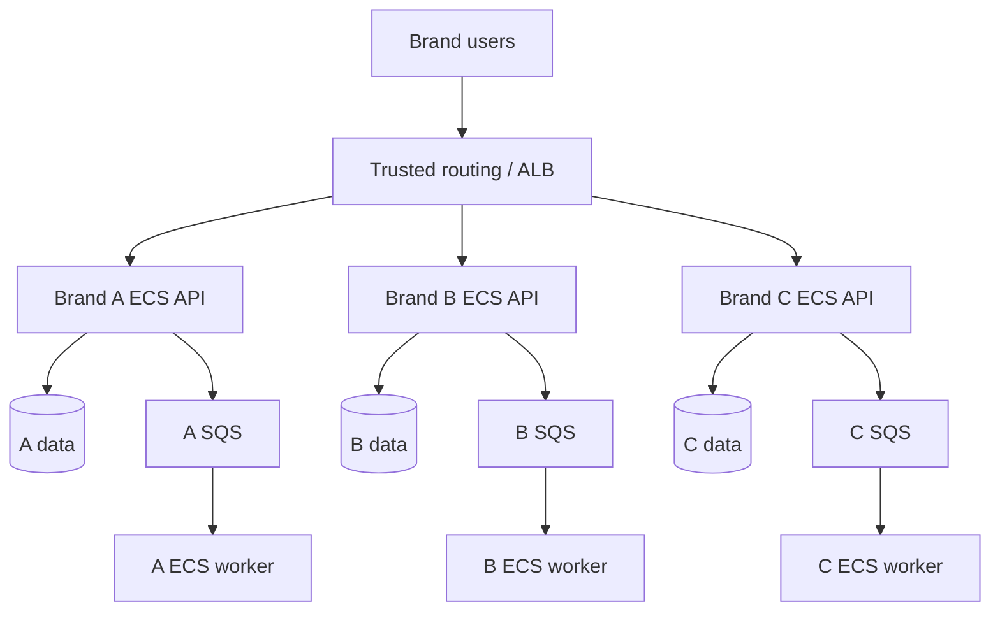
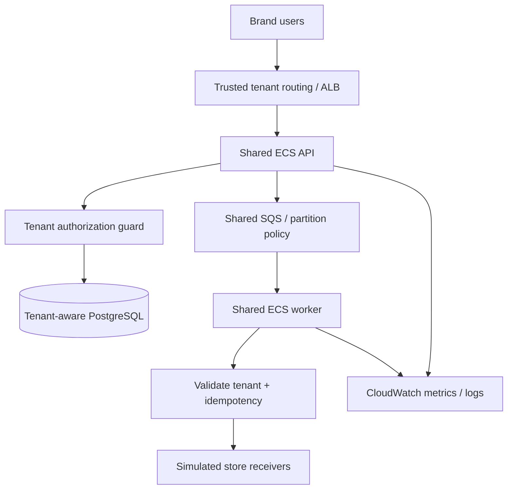

# 02. Architecture and decisions

**Status:** Proposed. The drawings describe intended states, not deployed infrastructure.

## Before — tenant-dedicated compute

Each brand has a separately deployed API/worker service and tenant-scoped data and permissions. Separate ECS clusters are *optional*; splitting clusters alone does not define an isolation boundary. Initially prefer ECS service/task separation over tripling all network resources.

## After — shared compute, explicit tenant isolation

## The hard engineering decisions

1. **PostgreSQL:** select tenant-specific databases/schemas or shared tables plus PostgreSQL RLS. Document separate owner/runtime roles and connection-pool context handling. Verify isolation using negative tests.
2. **SQS:** decide dedicated vs shared queue; never trust a tenant identifier contained solely in an arbitrary message. Set visibility timeout, DLQ and idempotency contract.
3. **ECS IAM:** task roles belong to tasks, **not** to individual HTTP tenants. Shared-task AWS-resource isolation requires explicit design (e.g. constrained STS role delegation); DB policies cannot be replaced with ECS cluster separation.
4. **Scaling:** establish observed scale-out delay, warm capacity, per-tenant fairness and shared-resource saturation.
5. **Migration:** preserve a single authoritative order-write path per tenant and an explicit source of truth.
6. **Networking:** private tasks, security-group-restricted DB access, ALB ingress, endpoint/NAT choice and its cost.
7. **Availability:** compare at equivalent minimum redundancy; do not claim a gain solely from having multiple ECS tasks.

## Proposed ADRs

- ADR-001: Dedicated vs pooled compute
- ADR-002: Tenant database security model
- ADR-003: Queue topology and exactly-one business effect
- ADR-004: Tenant routing and cutover data ownership
- ADR-005: Cost model, SLO and monitoring
