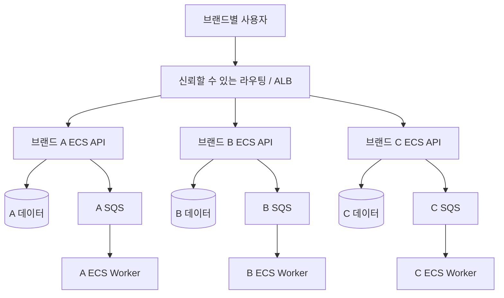
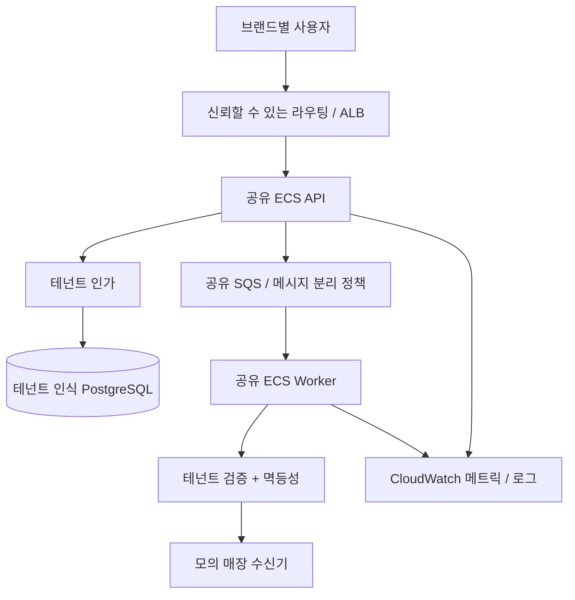

# 02. 아키텍처 및 설계 결정

**상태:** 제안된 구조입니다. 아래 다이어그램은 실제 배포가 완료된 결과가 아닙니다.

## Before — 브랜드별 독립 컴퓨팅

각 브랜드는 API와 Worker를 별도로 배포하고 데이터·권한을 테넌트별로 제한합니다. **ECS 클러스터 자체를 분리하는 것은 선택 사항**입니다. 비용을 고려해 우선 ECS 서비스/Task 단위 분리를 검토하며, 클러스터 분리만으로 데이터 격리를 보장한다고 주장하지 않습니다.

## After — 공유 컴퓨팅과 명시적 테넌트 격리

## 핵심 기술 의사결정

1. **PostgreSQL:** 테넌트별 DB/스키마 또는 공유 테이블 + RLS 중 선택. DB 소유자와 런타임 계정을 분리하고 연결 풀을 사용할 때 테넌트 컨텍스트 잔류 여부를 검증합니다.
2. **SQS:** 전용 Queue와 공유 Queue 비교. 임의 메시지의 테넌트 ID만 신뢰하지 않습니다. Visibility Timeout, DLQ, 멱등성 계약을 정의합니다.
3. **ECS IAM:** Task Role은 **Task 단위**이지 HTTP 요청의 개별 테넌트 단위가 아닙니다. 공유 Task에서 AWS 리소스를 테넌트별로 분리하려면 제한된 STS 역할 위임 등을 명시적으로 설계해야 합니다.
4. **확장:** 실제 Scale-out 지연, 사전 확보 용량, 테넌트별 공정성, 공유 자원 포화 구간을 측정합니다.
5. **전환:** 브랜드마다 단일 주문 쓰기 주체를 유지하고 데이터의 진실 공급원(Source of Truth)을 명확히 합니다.
6. **네트워크:** Private Task, DB 보안 그룹, ALB 진입점, VPC Endpoint/NAT 선택과 비용을 검토합니다.
7. **가용성:** 동일한 최소 중복성 기준으로 비교하며 ECS Task 수만으로 고가용성을 주장하지 않습니다.

## 계획된 ADR

- ADR-001: 독립 컴퓨팅과 공유 컴퓨팅
- ADR-002: 테넌트별 DB 보안 모델
- ADR-003: Queue 구조 및 비즈니스 중복 처리 방지
- ADR-004: 브랜드 라우팅과 Cutover 시 데이터 소유권
- ADR-005: 비용 모델, SLO, 모니터링
