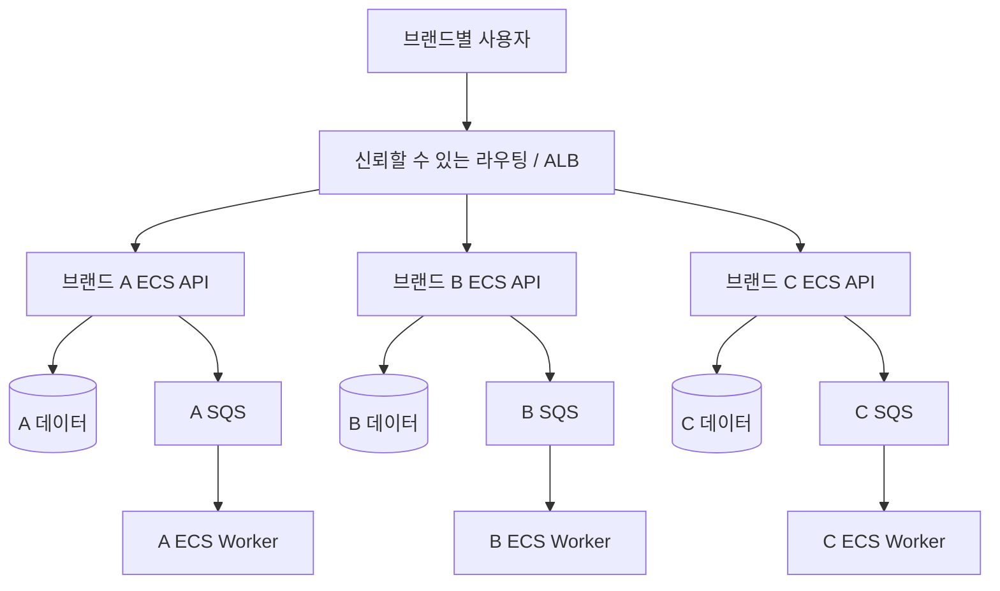
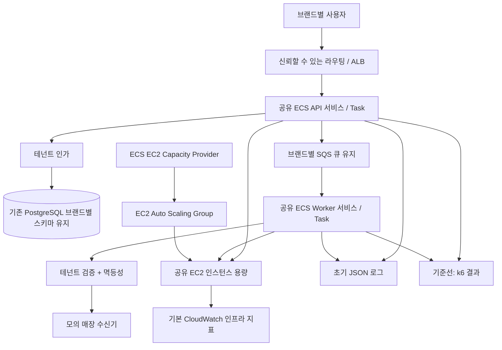

# 02. 아키텍처 및 설계 결정

**상태:** 제안된 구조입니다. 아래 다이어그램은 실제 배포가 완료된 결과가 아닙니다.

## Before — 브랜드별 ECS Fargate 독립 컴퓨팅

기존 기준선은 브랜드별 **ECS Fargate** 실행 환경입니다. 각 브랜드는 API와 Worker를 별도로 배포하고 데이터·권한을 테넌트별로 제한합니다. **ECS 클러스터 자체를 분리하는 것은 선택 사항**입니다. 비용을 고려해 우선 ECS 서비스/Task 단위 분리를 검토하며, 클러스터 분리만으로 데이터 격리를 보장한다고 주장하지 않습니다.

## After — 공유 ECS on EC2 + ASG, 명시적 테넌트 격리

위 도식에서 API/Worker와 EC2 연결선은 **Task가 EC2에서 실행되는 배치 관계**를 나타냅니다. Task 수 증설과 EC2 호스트 증설은 별개로, ECS Service Auto Scaling으로 desired Task 수를 늘린 후 용량이 부족하면 Capacity Provider의 관리형 확장 설정을 통해 ASG 용량을 조정합니다. AWS가 실제 트래픽을 직접 보고 EC2를 자동 증설한다는 뜻이 아닙니다.

**데이터 범위:** PostgreSQL은 기존 RDS와 브랜드별 스키마/권한을 유지하며 **DB 데이터 마이그레이션은 수행하지 않습니다.** 처음에는 SQS도 브랜드별 Queue를 유지해 메시지와 IAM 격리 수준을 보존합니다.

**관측 경계:** 초기에는 Source/Target에 JSON 로그, k6 결과, 기본 CloudWatch 메트릭만 수집합니다. 브랜드 A Cutover 후 관측 도구를 선택하고, 대시보드·경보·분산 추적을 고도화한 다음 두 아키텍처를 **동일 계측 조건에서 재측정**합니다. OpenTelemetry/Collector/Trace 백엔드는 아직 미확정입니다. 상세 내용은 [08. 관측 계층](08-observability.md)을 참조합니다.

## 핵심 기술 의사결정

1. **PostgreSQL:** Source/Target 모두 동일한 RDS PostgreSQL의 브랜드별 스키마를 사용합니다. DB 데이터 재배치 없이 브랜드별 DB 계정 권한 및 공유 Task의 테넌트 인가를 검증합니다.
2. **SQS:** 브랜드별 기존 Queue와 DLQ를 유지한 채 공유 Worker가 안전하게 소비하도록 설계합니다. 메시지의 테넌트 ID만 신뢰하지 않고 Visibility Timeout과 멱등성 계약을 정의합니다.
3. **ECS IAM:** Task Role은 **Task 단위**이지 HTTP 요청의 개별 테넌트 단위가 아닙니다. 공유 Task에서 AWS 리소스를 테넌트별로 분리하려면 제한된 STS 역할 위임 등을 명시적으로 설계해야 합니다.
4. **확장:** ECS Task 레벨의 Service Auto Scaling 및 EC2 Capacity Provider/ASG의 호스트 증설을 각각 관찰합니다. Task 대기(PENDING), 인스턴스 기동, 서비스 준비까지의 지연과 Noisy Neighbor를 측정합니다. Warm Pool은 별도 최적화 실험입니다.
5. **전환:** 브랜드마다 단일 주문 쓰기 주체를 유지하고 데이터의 진실 공급원(Source of Truth)을 명확히 합니다.
6. **네트워크:** Private Task, DB 보안 그룹, ALB 진입점, VPC Endpoint/NAT 선택과 비용을 검토합니다.
7. **가용성:** 동일한 최소 중복성 기준으로 비교하며 ECS Task 수만으로 고가용성을 주장하지 않습니다.
8. **관측(후반):** 초기에는 JSON 로그·k6·기본 CloudWatch 메트릭을 수집하고, 브랜드 A Cutover 이후 도구를 선택해 브랜드별 지연·오류·처리량, 장애·증설 원인을 분석합니다. 본격적 Trace/대시보드는 6단계에서 구성합니다.

## 계획된 ADR

- ADR-001: 브랜드별 ECS Fargate에서 공유 ECS on EC2/ASG로 전환
- ADR-002: 테넌트별 DB 보안 모델
- ADR-003: Queue 구조 및 비즈니스 중복 처리 방지
- ADR-004: 브랜드 라우팅과 Cutover 시 데이터 소유권
- ADR-005: 비용 모델 및 SLO
- ADR-006: Cutover 이후 관측 도구·Trace 저장소·비용 선택
