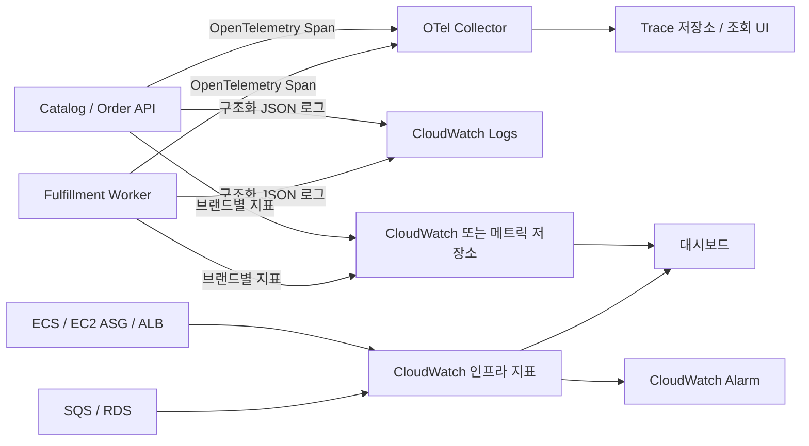

# 08. 필수 관측 계층 설계

> **상태: 설계 단계.** 아직 설치, 데이터 수집, 대시보드, 알림을 검증하지 않았습니다.

## 목적

이 프로젝트의 핵심 비교는 **브랜드별 ECS Fargate → 공유 ECS on EC2 + ASG** 전환입니다. 관측 계층은 다음 질문에 실제 근거로 답하기 위한 필수 기능입니다.

- 브랜드 A의 프로모션이 브랜드 B/C의 p95와 오류율에 영향을 주는가?
- 응답 지연의 원인이 API CPU, PostgreSQL, SQS 대기, Worker 처리 중 어디에 있는가?
- ECS Service Auto Scaling 및 Capacity Provider/ASG의 증설 과정에서 시간이 어디에 소요되는가?
- 브랜드 A의 Cutover 전후에 오류, 주문 누락, 지연이 발생했는가?
- 서비스 장애 발생 시 알림 → 로그 → Trace → 인프라 메트릭 순서로 원인을 확인할 수 있는가?

## 최소 관측 아키텍처

**실행 결정:** API/Worker는 OpenTelemetry SDK로 계측하고 Collector를 통해 Trace를 수집합니다. 조회·저장 백엔드는 구현 시 AWS X-Ray 또는 OTel 호환 도구 중 비용·운영 부담을 기준으로 선택해 ADR로 기록합니다. 구조화 로그와 AWS 인프라 메트릭의 기본 수집은 CloudWatch를 사용합니다. 전체를 처음부터 별도 Prometheus/Grafana/Tempo 스택으로 운영할 필요는 없습니다.

## 계측 경계

- **HTTP:** `service.name`, `http.route`, 응답 코드, 처리 시간, `trace_id` 및 `span_id`.
- **브랜드:** 인증 후 확정한 낮은 카디널리티의 `tenant_id`(A/B/C). 원본 토큰/사용자 ID/주문 ID를 메트릭 라벨로 사용하지 않습니다.
- **DB:** 쿼리 시간과 오류 및 DB 연결 대기; SQL 바인딩 값, 고객 정보는 저장하지 않습니다.
- **SQS:** 발행·수신·재시도 및 처리 지연. 메시지에 W3C Trace Context를 전달하되 테넌트 권한은 반드시 재검증합니다.
- **Worker/POS:** 전달 완료·실패·중복 처리 방지 결과를 주문 이벤트와 연결해 추적합니다.
- **인프라:** ALB 5xx/TargetResponseTime, ECS Task CPU·메모리·Task 수, EC2/ASG 용량, SQS 대기 메시지·최고 대기 시간, RDS 연결 수·CPU·지연.

## 필수 대시보드 및 알림

| 보드 / 알림 | 최소 지표 | 확인 목적 |
|---|---|---|
| 서비스/브랜드 | A·B·C별 RPS, p95, 오류율 | Noisy Neighbor, SLO |
| 컴퓨팅/확장 | Task desired/running/pending, EC2 ASG 용량, CPU/메모리 | Task 확장 vs 호스트 확장 |
| 주문 처리 | SQS 적체·대기 시간, Worker 처리량·실패 | 비동기 병목, 주문 누락 위험 |
| 데이터 | RDS CPU·연결 수·DB 호출 지연 | DB 공용 병목 |
| 운영 중 전환 | 라우팅 변경 시각, 브랜드별 5xx/p95/주문 수 | Cutover 영향 |
| 경보 | 5xx 증가, 주문 지연/큐 적체, Target 건강 상태 이상 | 이상 징후 조기 감지 |

**관측 비용도 전체 비교에 포함합니다.** 메트릭 수, 로그 보존 기간, Trace 샘플링 비율을 기록해 비용이 무제한 증가하지 않도록 설계합니다.

## 수용 기준(Definition of Done)

1. Source와 Target 환경에서 같은 이름·의미의 브랜드별 핵심 지표를 확인한다.
2. 정상 주문 하나의 **API → DB → SQS → Worker → 모의 POS** 흐름을 Trace 또는 상관관계 ID로 추적할 수 있다. 비동기 구간은 실제 구현한 Trace Context 전파 방식 및 샘플링 제약을 명시한다.
3. 장애 또는 지연 요청 하나를 Trace ID와 구조화 로그로 추적하고, 관련 CloudWatch 인프라 지표와 연결해 원인을 설명한다.
4. 브랜드 A의 급증 부하에서 B/C의 지연을 동일한 타임라인에서 확인한다.
5. 확장 과정의 Task/EC2 증설 시각과 지연, Cutover 이벤트를 대시보드에 기록한다.
6. 경보를 한 번 의도적으로 발생시켜 발화·복구 내역과 Runbook을 남긴다.
7. 로그/Trace에서 비밀·개인정보 노출이 없음을 표본 검토한다.

## 구현 순서

1. HTTP 구조화 로그 및 브랜드별 RED(Requests·Errors·Duration) 메트릭.
2. OpenTelemetry SDK와 Collector 연결, API/DB 구간 Trace.
3. SQS Trace Context 전달 및 Worker/모의 POS 상관관계.
4. CloudWatch 인프라 지표와 대시보드 및 경보.
5. 부하·장애·Cutover 실험에서 실제 증거 캡처.

관측의 구현 범위를 고정하기 위한 문서이며, **설계·도구 도입만으로 완료 처리하지 않습니다.**
